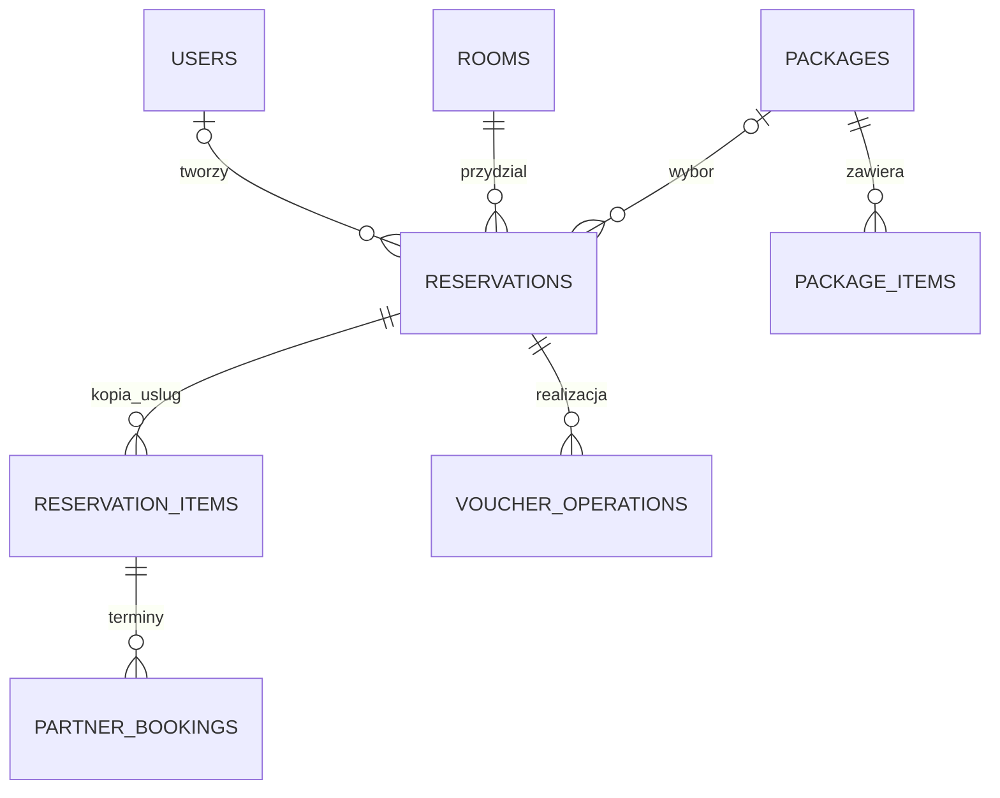
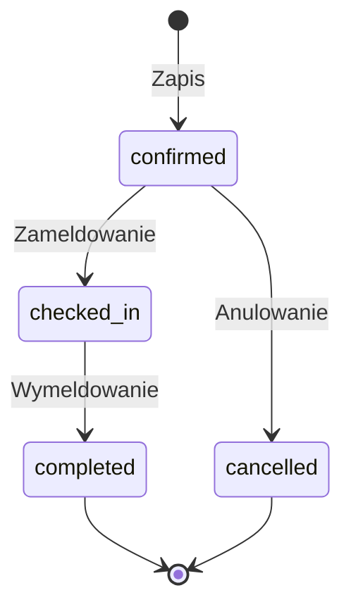

# Jak działa aplikacja

Całość uruchamiamy jako jeden backend i jeden interfejs. W czasie pracy Vite obsługuje frontend i przekazuje żądania `/api` do Express. Po zbudowaniu Express może też podawać pliki frontendu. SQLite przechowuje dane w jednym pliku, więc na pokaz nie trzeba instalować osobnego serwera bazy.

## Podział kodu

| Miejsce                     | Odpowiedzialność                                    |
| --------------------------- | --------------------------------------------------- |
| `backend/src/config.ts`     | Zmienne środowiska i sprawdzenie ich wartości       |
| `backend/src/db.ts`         | Schemat bazy, zapytania i transakcje                |
| `backend/src/security.ts`   | Sesje, hasła, role, CSRF, szyfrowanie i audyt       |
| `backend/src/auth.ts`       | Rejestracja, logowanie i własny profil              |
| `backend/src/hotel.ts`      | Pokoje, pakiety, dostępność i cykl pobytu           |
| `backend/src/integrations/` | Połączenia A/B/D, lokalny stan operacji i symulator |
| `frontend/src/api.ts`       | Wspólny sposób wywoływania API i obsługi błędów     |
| `frontend/src/pages/`       | Ekrany i formularze                                 |
| `docs/openapi.yaml`         | Kontrakt API C                                      |

Reguły, od których zależy zapis danych, są w backendzie. Walidacja formularza pomaga użytkownikowi, ale nie zastępuje sprawdzenia ceny, terminów i uprawnień przez serwer.

## Dane i relacje

Rezerwacja należy do użytkownika albo partnera, np. D. Tożsamością partnera jest oznaczenie partnera, a nie pojedynczy klucz API. Wymiana klucza nie pozbawia więc D dostępu do jego wcześniejszych rezerwacji. Recepcja i administrator widzą wszystkie pobyty; klient widzi swoje. Numer rezerwacji służy do rozmowy z gościem, a `id` do wywołań API.

Pobyt przechowuje kopię ceny i składników pakietu. Zmiana cennika nie zmienia samoczynnie już zapisanej rezerwacji. Kwoty zapisujemy jako całkowite grosze (`10000` to 100 PLN). Cena to liczba nocy razy stawka pokoju plus jednorazowa cena pakietu. Nie liczymy płatności ani faktur.

## Zapis pobytu bez dwóch rezerwacji jednego pokoju

Termin pobytu to przedział `[checkIn, checkOut)`. Wyjazd jednego gościa i przyjazd drugiego tego samego dnia są dozwolone. Istnieje konflikt, gdy `istniejacy.checkIn < nowy.checkOut` oraz `istniejacy.checkOut > nowy.checkIn`.

Zapis używa transakcji `BEGIN IMMEDIATE`: najpierw blokujemy zapis, potem ponownie sprawdzamy dostępność i dopiero dodajemy rezerwację. Dwa równoległe żądania nie mogą oba przejść kontroli na nieaktualnym stanie. W transakcji nie wykonujemy `await` ani połączeń z partnerami. Z tego powodu w implementacji wybrano `node:sqlite` zamiast Prisma proponowanego w pierwszym planie. Jest to uproszczenie stosu i jawna kontrola transakcji, a nie zmiana zasad działania projektu.

`expectedTotalMinor` chroni przed przyjęciem innej ceny niż zaakceptowana. `expectedVersion` chroni edycję przed nadpisaniem cudzej zmiany. Przy konflikcie interfejs ma odświeżyć dane i ponownie poprosić o decyzję.

Klient zmienia i anuluje potwierdzony pobyt przed dniem przyjazdu. W dniu przyjazdu pomaga recepcja. Zmiana dat przy aktywnych lub niepewnych usługach zewnętrznych wymaga najpierw uporządkowania tych usług. Przy zmianie dat pobytu z voucherem C ponownie pyta D o ważność części hotelowej dla nowego terminu. Dopiero po poprawnej odpowiedzi zapisuje zmianę, ponownie sprawdzając wersję i powiązanie. Odmowa albo awaria D pozostawia poprzedni pobyt bez zmian.

## Dlaczego integracje mają osobny stan

Brak odpowiedzi nie mówi, czy partner wykonał żądanie. Przed zapisem wysyłamy stały `operationId` i zachowujemy operację lokalnie. Po timeout nie zamawiamy drugi raz z nowym identyfikatorem: odpytujemy wynik. Niepewny termin nadal blokuje nakładający się termin tej samej osoby.

Dla zamówienia A/B zapisujemy także zaszyfrowaną kopię wysłanej treści w `partnerOperationRequests`. Jeśli podczas odświeżania partner odpowie 404, zamówienie nadal jest niepewne i nie ma jeszcze zewnętrznego id, można ponowić dokładnie tę kopię z tym samym `operationId`. Partner musi rozpoznawać powtórzenia również wtedy, gdy pierwsze żądanie nadal trwa. Starszej operacji bez zapisanej kopii nie wysyłamy ponownie w ten sposób.

Tabela `integrationOperationTargets` wiąże operację A/B oraz zgłoszenie wykonania do D z trybem i adresem, pod którym je rozpoczęto. Zmiana `demo` na `real` lub `baseUrl` nie przenosi starej operacji do nowego systemu. Aby ją wyjaśnić, trzeba przywrócić poprzednie środowisko. Sam klucz można wymienić bez zmiany celu operacji.

Anulowanie całego pobytu najpierw wyjaśnia usługi A/B. Jeżeli partner nie potwierdzi anulowania, pobyt nie jest przedstawiany jako w pełni anulowany. Działa tu kilka systemów, więc nie udajemy jednej transakcji obejmującej wszystkie bazy.

D potwierdza ważność vouchera, jego właściciela/usługodawcę i konkretny składnik hotelowy. Nie przyjmujemy oznaczenia „opłacone voucherem” na słowo od formularza. Niedostępność D blokuje zameldowanie z voucherem. Przy wymeldowaniu pobyt kończy się lokalnie, a zgłoszenie wykonania części C można ponowić. Nie realizujemy części A/B ani całego vouchera za partnerów.

## Bezpieczeństwo i ograniczenia

Hasła są haszowane przez scrypt z losową solą. Sesja jest po stronie serwera; przeglądarka dostaje cookie `HttpOnly`, a mutacje wymagają tokenu CSRF. Klucze przychodzące są przechowywane jako skróty, a sekrety wychodzące i numery voucherów jako szyfrogramy AES-GCM. Odpowiedzi administracyjne nie zwracają zapisanego sekretu.

Partner dostaje jawnie wybrane zakresy dostępu. Backend sprawdza także własność konkretnej rezerwacji. Nieznane pola zapisu są odrzucane, żeby klient nie mógł np. sam ustawić statusu lub źródła finansowania. Audyt zapisuje istotne zmiany bez haseł i tokenów.

To projekt jednego hotelu i pojedynczej instancji serwera. Nie obejmuje rozproszonej bazy, płatności online, wysyłki e-mail ani pełnej obsługi księgowej. Tryb `demo` pozwala sprawdzić nasze przepływy, ale nie potwierdza zgodności z wdrożeniami innych grup.
