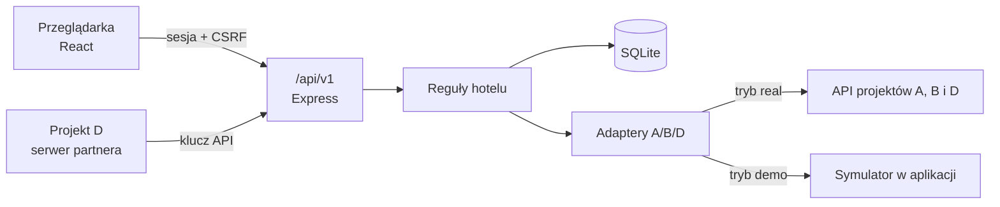
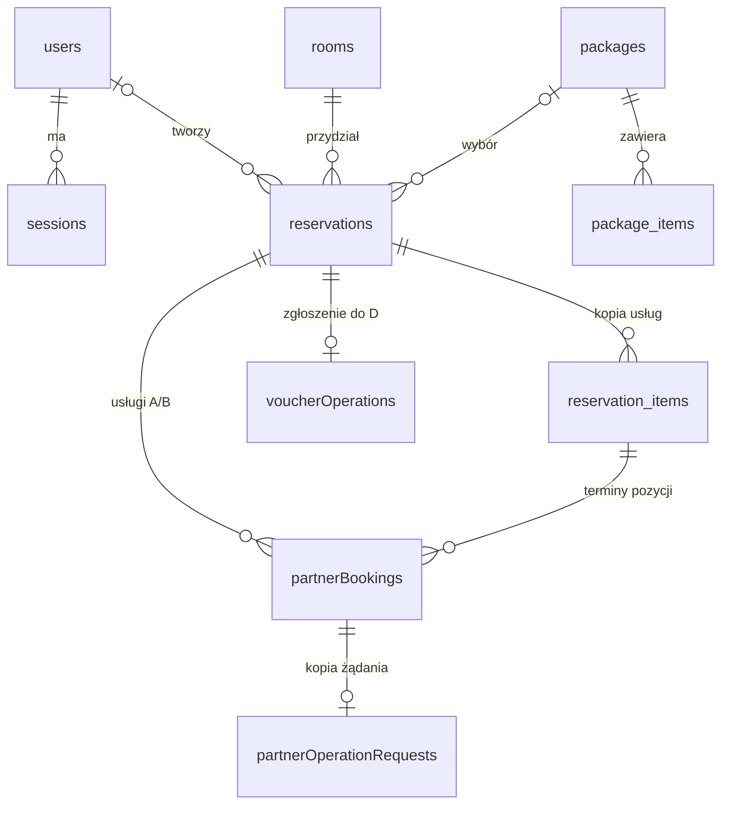
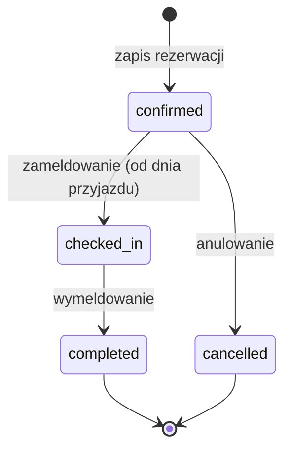

# Budowa aplikacji

Przeznaczenie: architektura, moduły, model danych i najważniejsze mechanizmy. Opiekun: Wiktoria Sobejko. Backend jest obszarem Andriiego, a interfejs Rafała; Adrian pomaga przy implementacji i połączeniu całości.

## Jak jest zbudowany projekt

Aplikacja ma interfejs React, serwer Express i bazę SQLite; obie części są napisane w TypeScript. Podczas pracy Vite uruchamia interfejs i przekazuje żądania `/api` do serwera. Po zbudowaniu Express obsługuje także pliki interfejsu, więc całość działa pod jednym adresem. Baza jest jednym plikiem i nie wymaga osobnego serwera.



Reguły, od których zależy zapis danych, są w serwerze. Formularze sprawdzają dane dla wygody użytkownika, ale serwer zawsze sprawdza je ponownie, razem z ceną, terminem i uprawnieniami.

## Gdzie szukać kodu

| Plik lub katalog                        | Co zawiera                                                                   |
| --------------------------------------- | ---------------------------------------------------------------------------- |
| `backend/src/config.ts`                 | Odczyt i sprawdzenie ustawień środowiska                                     |
| `backend/src/db.ts`                     | Tabele, zapytania i transakcje                                               |
| `backend/src/security.ts`               | Hasła, sesje, role, CSRF, szyfrowanie, limit żądań i historia operacji       |
| `backend/src/auth.ts`                   | Rejestracja, logowanie i profil                                              |
| `backend/src/hotel.ts`                  | Pokoje, pakiety, dostępność i cykl pobytu                                    |
| `backend/src/admin.ts`                  | Edycja oferty, kont i ustawień hotelu, historia operacji                     |
| `backend/src/integrations/router.ts`    | Operacje API dla planu pobytu, partnerów, kluczy i voucherów                 |
| `backend/src/integrations/services.ts`  | Reguły usług A/B i vouchera D                                                |
| `backend/src/integrations/adapters.ts`  | Wywołania A/B/D oraz symulator trybu demo                                    |
| `backend/src/integrations/transport.ts` | Połączenie HTTP z partnerem: dozwolone hosty, limit czasu, brak przekierowań |
| `backend/src/integrations/store.ts`     | Tabele integracji, szyfrowanie sekretów i sprawdzanie kluczy API             |
| `backend/src/app.ts`, `server.ts`       | Kolejność warstw serwera, nagłówki bezpieczeństwa, start i zamknięcie        |
| `frontend/src/api.ts`                   | Wywołania API z interfejsu i obsługa błędów                                  |
| `frontend/src/pages/`                   | Ekrany i formularze                                                          |
| `backend/tests/`, `frontend/e2e/`       | Testy serwera i testy w przeglądarce                                         |
| `docs/openapi.yaml`                     | Kontrakt API                                                                 |
| `scripts/`                              | Przygotowanie środowiska i kopia bazy                                        |

Ekrany interfejsu:

| Adres w aplikacji     | Ekran                                           | Kto ma dostęp |
| --------------------- | ----------------------------------------------- | ------------- |
| `/`, `/rooms`         | Oferta, wyszukiwarka i formularz rezerwacji     | Każdy         |
| `/login`, `/register` | Logowanie i rejestracja                         | Każdy         |
| `/reservations`       | Lista rezerwacji; dla personelu pulpit recepcji | Zalogowani    |
| `/reservations/:id`   | Szczegóły pobytu, goście i plan usług           | Zalogowani    |
| `/profile`            | Profil i zmiana hasła                           | Zalogowani    |
| `/admin/offer`        | Pokoje i pakiety                                | Administrator |
| `/admin/users`        | Konta i role                                    | Administrator |
| `/admin/integrations` | Połączenia A/B/D, klucze API, vouchery testowe  | Administrator |
| `/admin/settings`     | Nazwa hotelu i godziny pobytu                   | Administrator |
| `/admin/audit`        | Historia operacji                               | Administrator |

Ukrycie ekranu w interfejsie jest tylko wygodą. O dostępie decyduje serwer; opis jest w [projekcie endpointów](api/projekt-endpointow.md).

## Baza danych



| Tabela                             | Co przechowuje                                                                                        |
| ---------------------------------- | ----------------------------------------------------------------------------------------------------- |
| `users`                            | Konta: e-mail (unikalny), skrót hasła, rola, aktywność, wymuszona zmiana hasła                        |
| `sessions`                         | Sesje: skrót identyfikatora, użytkownik (pusty dla sesji anonimowej), token CSRF, termin ważności     |
| `rooms`                            | Pokoje: numer (unikalny), typ, pojemność, cena za noc w groszach, wyposażenie, aktywność              |
| `packages`, `package_items`        | Pakiety i ich usługi: nazwa, wykonawca (`HOTEL`, `A`, `B`), identyfikator oferty partnera, liczba     |
| `reservations`                     | Pobyty: numer, właściciel (użytkownik albo partner), pokój, daty, goście, stan, ceny, wersja, voucher |
| `reservation_items`                | Kopia usług pakietu z chwili rezerwacji, przypisanie do gościa, stan i notatka                        |
| `idempotency_records`              | Klucze ponowienia utworzenia rezerwacji wraz z zapisaną odpowiedzią                                   |
| `audit_events`                     | Historia operacji: autor, czas, operacja, obiekt i bezpieczny opis                                    |
| `hotel_settings`                   | Nazwa hotelu, godziny przyjazdu i wyjazdu, strefa czasowa, waluta                                     |
| `integrations`                     | Ustawienia połączeń z A, B i D: tryb, adres, limit czasu, zaszyfrowany sekret, wynik ostatniego testu |
| `partnerKeys`                      | Klucze dostępu do API hotelu: oznaczenie partnera, skrót klucza, zakresy, aktywność                   |
| `partnerBookings`                  | Zamówienia usług A/B: termin, stan, identyfikator operacji i identyfikator nadany przez partnera      |
| `partnerOperationRequests`         | Zaszyfrowana kopia wysłanego zamówienia, potrzebna do bezpiecznego ponowienia                         |
| `integrationOperationTargets`      | Tryb i adres, pod którym rozpoczęto operację                                                          |
| `voucherOperations`                | Zgłoszenie wykonania hotelowej części vouchera do D, jedno na pobyt                                   |
| `partnerDemoState`, `demoVouchers` | Stan symulatora partnerów i vouchery testowe trybu demo                                               |

Rezerwacja należy do użytkownika, który ją utworzył, albo do partnera, np. D. Partnera rozpoznajemy po jego oznaczeniu, a nie po pojedynczym kluczu, więc wymiana klucza API nie odbiera mu dostępu do wcześniejszych rezerwacji. Recepcja i administrator widzą wszystkie pobyty, klient i partner tylko własne. Numer pobytu (np. `AH-2026-1A2B3C4D`) służy do rozmowy z gościem; w API używamy `id`.

Kwoty zapisujemy w groszach: `10000` oznacza 100 zł. Cena pobytu to liczba nocy razy stawka pokoju plus jednorazowa cena pakietu. Rezerwacja zachowuje kopię ceny i kupionych usług; późniejsza zmiana oferty ich nie podmienia.

## Rezerwowanie pokoju

Termin zapisujemy jako przedział `[checkIn, checkOut)`. Dzięki temu nowy gość może przyjechać w dniu wyjazdu poprzedniego. Dwie rezerwacje kolidują, gdy:

```text
istniejacy.checkIn < nowy.checkOut
oraz
istniejacy.checkOut > nowy.checkIn
```

Transakcja `BEGIN IMMEDIATE` zakłada blokadę zapisu przed odczytem dostępności. Dopiero wtedy serwer sprawdza termin i zapisuje pobyt. Gdy dwa żądania trafią jednocześnie, drugie sprawdzi już zmienioną bazę. W transakcji nie wykonujemy `await` ani połączeń HTTP. To powód użycia `node:sqlite` zamiast Prisma z pierwszej wersji planu: transakcję i kolejność sprawdzeń widać bezpośrednio w kodzie.

Trzy pola chronią przed pomyłką przy zapisie:

- `Idempotency-Key` (przy tworzeniu) pozwala rozpoznać ponowione żądanie i zwrócić wcześniejszy wynik zamiast drugiej rezerwacji;
- `expectedVersion` (przy zmianie) chroni przed nadpisaniem nowszej zmiany;
- `expectedTotalMinor` sprawdza, czy cena nadal zgadza się z zaakceptowaną przez klienta.

Konflikt oznacza, że trzeba odświeżyć dane i świadomie ponowić operację.



Klient może zmienić lub anulować potwierdzony pobyt przed dniem przyjazdu; później robi to recepcja. Przed zmianą dat trzeba anulować aktywne usługi A/B i wyjaśnić operacje z niepewnym wynikiem. Dla pobytu z voucherem serwer sprawdza nowy termin w D; odmowa lub brak odpowiedzi pozostawia poprzednie dane.

## Co dzieje się przy awarii partnera

Brak odpowiedzi nie mówi, czy partner wykonał żądanie. Dlatego przed wywołaniem A/B zapisujemy lokalną operację i jej stały `operationId`. Po przekroczeniu czasu wynik pozostaje niepewny (`unknown`), a taka usługa nadal blokuje nakładający się termin tego gościa. Nie zamawiamy drugi raz z nowym identyfikatorem: odpytujemy o wynik.

Stany zamówienia A/B: `pending`, `confirmed`, `completed`, `rejected`, `unknown`, `cancel_pending`, `cancelled`. Usługa pakietu bez zamówienia ma stan `unplanned`. Zakończenie usługi pochodzi z odpowiedzi A/B przy odświeżeniu, nie z ręcznej edycji w hotelu.

W `partnerOperationRequests` jest zaszyfrowana kopia wysłanego zamówienia. Odświeżenie najpierw pyta partnera o wynik. Jeśli partner zwróci 404, a lokalny zapis nadal jest niepewny i nie ma identyfikatora nadanego przez partnera, aplikacja może ponowić dokładnie tę kopię z tym samym `operationId`. Partner musi rozpoznawać powtórzenia także wtedy, gdy pierwsze żądanie nadal trwa.

`integrationOperationTargets` przechowuje tryb i adres rozpoczętej operacji A/B lub zgłoszenia do D. Po zmianie `demo` na `real` albo adresu API nie wysyłamy starego żądania do nowego systemu. Żeby je wyjaśnić, trzeba przywrócić poprzednie ustawienia. Sam klucz można wymienić bez zmiany celu.

Przy anulowaniu pobytu serwer najpierw anuluje usługi A/B. Jeśli choć jedna nadal czeka na potwierdzenie, hotel pozostaje aktywny. Każdy projekt ma własną bazę, więc nie udajemy jednej transakcji obejmującej wszystkie systemy.

D potwierdza ważność i przypisanie hotelowej części vouchera. Brak odpowiedzi D blokuje utworzenie pobytu z voucherem, zameldowanie, zmianę dat i anulowanie takiego pobytu. Wymeldowanie działa inaczej: kończy pobyt lokalnie, a zgłoszenie wykonania do D można ponowić. Stany zgłoszenia: `pending`, `reported`, `rejected`, `unknown`; dopóki pobyt się nie zakończył, zgłoszenia nie ma. Hotel potwierdza tylko część C; masaż i trening potwierdzają ich wykonawcy.

Operacje zewnętrzne jednej rezerwacji wykonują się po kolei: blokada w pamięci procesu nie pozwala, żeby odświeżenie i anulowanie tej samej usługi nadpisały sobie wyniki.

## Bezpieczeństwo

- Hasła są haszowane przez scrypt z losową solą. Logowanie na nieistniejące konto trwa tyle samo co na istniejące.
- Sesje są zapisane na serwerze. Przeglądarka dostaje cookie `aurora_session` z flagami `HttpOnly` i `SameSite=Lax` (oraz `Secure` przy HTTPS). W bazie jest tylko skrót identyfikatora sesji.
- Żądania zmieniające dane wymagają tokenu CSRF związanego z sesją i zgodnego nagłówka `Origin`.
- Klucze dostępu do API hotelu przechowujemy jako skróty SHA-256; pełną wartość widać tylko raz, przy utworzeniu.
- Klucze do partnerów i numery voucherów szyfrujemy AES-256-GCM kluczem `CONFIG_ENCRYPTION_KEY`. Odpowiedzi administracyjne zwracają tylko maskę.
- Serwer sprawdza rolę, zakres klucza i właściciela rezerwacji. Odrzuca nieznane pola, żeby klient nie mógł sam zmienić statusu, właściciela ani źródła finansowania.
- Historia operacji zawiera autora, czas i opis zmiany bez haseł oraz kluczy.
- Wygasłe sesje i klucze ponowienia starsze niż 7 dni są usuwane przy starcie serwera i co godzinę.

## Ograniczenia

Uruchamiamy jedną instancję serwera dla jednego hotelu. Blokady dłuższych operacji HTTP i limit żądań działają w pamięci tego procesu. Projekt nie obejmuje wielu hoteli, rozproszonej bazy, płatności, faktur ani wysyłki e-maili. Tryb `demo` pozwala sprawdzić nasze przepływy, ale nie potwierdza zgodności z aplikacjami innych grup.

Kontrakt i przykłady żądań są w [instrukcji API](api/README.md), a uruchomienie i ustawienia w [konfiguracji](konfiguracja.md).
